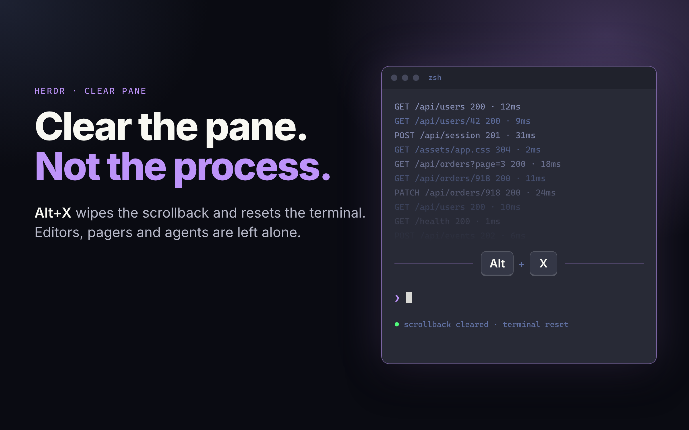

# herdr-clear-pane



A [Herdr](https://herdr.dev) desktop mod that clears the focused terminal's screen and scrollback and resets it, like kitty's `clear_terminal reset`. Bound to `Alt+X` by default.

> **This is a workaround.** Herdr's desktop app has no clear command yet; it is requested in [herdr-app#341](https://github.com/herdrdev/herdr-app/issues/341). Once a native `terminal.clear` ships, use that and drop this mod.

## What it does

- Writes a terminal reset (`ESC c`) to the focused terminal's tty, as if the running program had printed it. The program receives no input, so a long-running program such as a dev server keeps running.
- At a shell prompt (`zsh`, `bash`, `fish`) it then presses `Ctrl+L`, which redraws the prompt.
- It does nothing while an agent (Claude Code, Codex, ...), an editor, a pager or another full-screen program is in the foreground. A reset would corrupt what they have drawn.

## Install

Requires the Herdr desktop app on Linux.

```sh
git clone https://github.com/Cosmicist/herdr-clear-pane
cp -r herdr-clear-pane/mods/clear-pane ~/.config/herdr-app/mods/
herdr-app check ~/.config/herdr-app/mods/clear-pane
```

Then add the key from [`keys.json`](keys.json) to the `global` section of `~/.config/herdr-app/keys.json`:

```json
"alt-x": "mod.open:clear-pane"
```

`Alt+X` is not bound by Herdr by default, but it is taken from whatever program has focus. Pick another key if you need it.

## Settings

Optional. Create `herdr-clear-pane/settings.json` in `$XDG_CONFIG_HOME` (`~/.config` when it isn't set); it is read on every key press, so edits apply at once. It lives outside Herdr's app folder so you can keep it in a dotfiles repo.

```json
{ "toast": "skipped" }
```

| `toast` | Shows a toast when |
| --- | --- |
| `"never"` (default) | never |
| `"skipped"` | nothing was cleared because a program keeps its own screen ("less keeps its own screen.") |
| `"always"` | the pane was cleared, and also in the skipped case |

A missing file means the defaults. An invalid file or value shows a warning toast and uses the defaults.

## Skipped programs

An agent is detected from Herdr's program table. Everything else is matched by the foreground process name, from the `KEEPS_OWN_SCREEN` list in [`mods/clear-pane/main.js`](mods/clear-pane/main.js):

`vim` `nvim` `vi` `view` `vimdiff` `nano` `emacs` `hx` `kak` `micro` `less` `more` `most` `man` `bat` `htop` `btop` `top` `tmux` `screen` `lazygit` `yazi`

A full-screen program that is not on the list will be reset. Add its process name to the list.

## Differences from the TUI's `clear_pane`

The Herdr TUI's `clear_pane` calls the terminal engine directly: it keeps the current line, never touches the alternate screen, and sends nothing to the program. A mod cannot call the engine, so this mod:

- performs a full reset, so the screen is blank until the program prints again (a shell prompt is redrawn by the `Ctrl+L` step);
- recognises full-screen programs by name instead of by the alternate-screen state.

## Limits

- `XDG_CONFIG_HOME` is read through Herdr's `exec`, so it is the value Herdr runs programs with. A relative value is ignored. A non-default value is untested here (it is unset on the test machine); if it isn't picked up, the mod falls back to `~/.config`.
- **Linux only.** It finds the terminal's tty through `/proc/<pid>/fd/0` and writes to `/dev/pts/*`. macOS and Windows are not supported.
- Tested on Herdr app 0.1.13 and herdr-core 0.1.18, with zsh.
- The mod runs programs: `hc get`, `readlink`, `sh` (a single `printf` to the tty) and `hc keys`. It reads the terminal's `/proc/<pid>/fd/0` link, `$XDG_CONFIG_HOME` (through `sh`) and `settings.json`, and it uses no network.

## License

[MIT](LICENSE)
