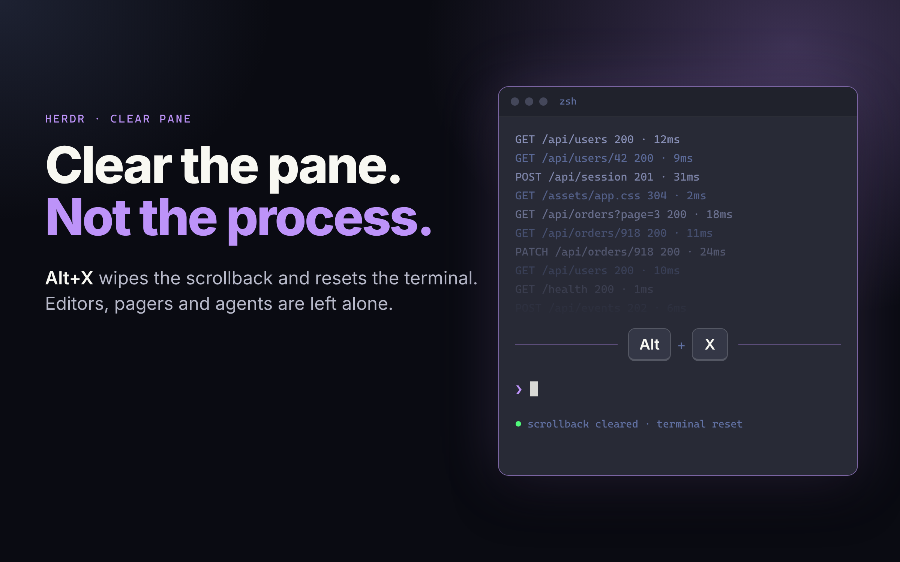

# Clear pane

A headless mod that clears the focused terminal's scrollback and resets it, like kitty's `clear_terminal reset`, on one key. A workaround until Herdr has a native clear command ([herdr-app#341](https://github.com/herdrdev/herdr-app/issues/341)).

## What you see

Nothing, normally. Pressing `Alt+X` clears the focused terminal, history included. At a shell prompt the prompt reappears at the top. Over a dev server such as vite the screen goes blank until the server prints again. If something fails, an error toast reads "Clear pane failed" with the reason.

## How it behaves

- It acts on `focused().terminal` at the moment the key is pressed.
- It does nothing when the foreground program is an agent (`program.agent` in `terminals()`), or its process name is in `KEEPS_OWN_SCREEN` (editors, pagers including `bat`, `htop`, `btop`, `top`, `tmux`, `screen`, `lazygit`, `yazi`). A name suffix such as `vim.basic` is ignored.
- Otherwise it writes `ESC c` to the terminal's tty, so the foreground program receives no input.
- If the foreground program is `zsh`, `bash` or `fish`, it then presses `ctrl+l` through `hc keys` so the shell redraws its prompt.
- With no focused terminal (a mod pane), it does nothing.

## Built from

- `mods/clear-pane/mod.json`: `{ "place": "none", "overlay": { "kind": "popup", "frame": "none", "width": 1, "height": 1 } }`. The mod appears only as a 1px frameless popup opened by `mod.open`.
- `mods/clear-pane/main.js`: a `View` whose `init` reads `focused()`, then in `cx.spawn` runs `hc get <t>` (JSON with `pid` and `foreground.name`), `readlink /proc/<pid>/fd/0` (must start with `/dev/pts/`), `sh -c 'printf "\033c" > "$1"' sh <tty>`, and `hc keys <t> ctrl+l`. `render` returns an empty `div()`.
- `keys.json`: `"alt-x": "mod.open:clear-pane"` in `global`.
- `herdr` functions used: `focused`, `terminals`, `hc`, `exec`, `props`, `closeOverlay`, `notify`.

## Watch out

- The mod runs inside the 1px popup that `mod.open` opens. Close that popup only after the work finishes (`finally`). Closing it right away in `init` meant the work never ran in testing, most likely because closing it ends the mod and its `cx.spawn` task.
- `props()` is null under `herdr-app check`, so read `props()?.overlay`.
- The foreground process name is not always the command: `vim` can be `vim.basic`.
- Linux only: macOS has no `/proc`, and Windows has no `/dev/pts`.
- It is not the TUI's `clear_pane`: that keeps the current line and detects the alternate screen through the engine, which mods cannot reach.

## Done when

- `herdr-app check mods/clear-pane` passes.
- In a terminal running `sleep 600` after 300 printed lines, `Alt+X` leaves `hc read <t>` with no history, and `sleep` is still running.
- At a zsh prompt after `seq 1 300`, `Alt+X` leaves no history and a redrawn prompt.
- With `less`, `vim`, `nvim` or `nano` in the foreground, `Alt+X` leaves the screen unchanged.
- With Claude Code in the foreground, `Alt+X` leaves the screen unchanged.
- Scrolling up in the window after `Alt+X` shows no old output.
